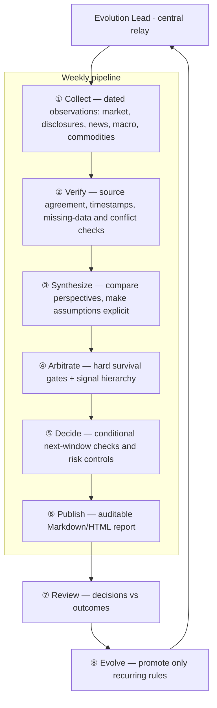
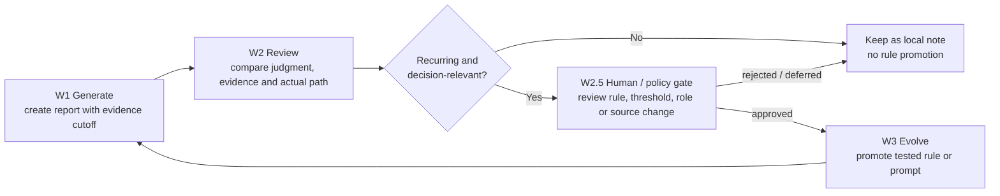
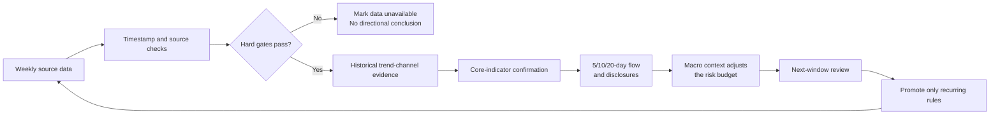

<div align="center">

# Antifragile Decision Loop

### Antifragile Weekly Review: Macro-Informed Decision Support

**Collect. Verify. Debate. Arbitrate. Review. Evolve.**

An evidence-first weekly review loop with an eight-role expert council and bounded self-improvement. Macro context informs the risk budget — it never manufactures a conclusion on its own.

[English](README.md) | [Español](docs/README.es.md) | [简体中文](docs/README.zh-CN.md)

[](LICENSE)
[](https://www.python.org/)
[](#install)
[](#bounded-self-improvement)
[](#privacy-boundary)

**[Why](#why-this-project) · [Expert council](#the-expert-council) · [Signal hierarchy](#signal-hierarchy) · [Evolution](#bounded-self-improvement) · [Quick start](#quick-start) · [Live preview](docs/preview.html) · [Privacy](#privacy-boundary)**

</div>

> [!IMPORTANT]
> This repository is for research and decision support only. It does not take any external action on your behalf, and it does not provide investment advice.

## Why This Project

Most single-operator research workflows are too fast to audit and too slow to learn from: daily noise is mistaken for a trend, old news is used as a catalyst, and a single data point is treated as a verified conclusion.

**Antifragile Decision Loop** packages a slower, rule-led alternative for weekly review and next-window preparation — not short-term prediction. Verified macro factors adjust the risk budget; they never override evidence or create a directional conclusion on their own. Its two differentiators are:

1. **Expert council:** collection, verification, synthesis, arbitration, decision and publishing are separate stages with explicit handoff contracts — one accountable owner per stage, nothing bypasses the relay.
2. **Bounded self-improvement:** each report is reviewed against the information available at its cutoff; only recurring, decision-relevant and policy-approved rules are promoted.

Its reusable methods are:

- **Weekly measurement:** calculate movement from the first actual data open to the last actual close of the same week.
- **Evidence gates:** verify values, activity, timestamps, source agreement, and missing-data status before interpretation.
- **Signal hierarchy:** historical trend-channel evidence carries the highest contextual weight only after data-quality and survival-risk gates pass; core-indicator confirmation, multi-window capital flow, disclosures, and macro context follow.
- **Via Negativa:** a narrative without a dated, verifiable source cannot become a decision reason.
- **Time-safe review:** a report may only be judged using information public by its `evidence_cutoff`; later disclosures are new events, not proof that the prior report should have known them.
- **Evolution loop:** retain recurring process rules, while keeping weekly opinions and generated reports local.

The repository contains a public reference runner, a configurable focus-list template, the public research protocol, the expert-council design, the evolution-loop contract, and tests. Your own focus list, account data, API credentials, reports, and local caches stay outside Git.

The public entry point is intentionally small: `weekly_review.py` creates a research scaffold, while `run_weekly_report.py` is only a compatibility wrapper. Source-specific data clients belong in a local adapter and are never required by the public core.

## The Expert Council

The coordinator routes work through six delivery stages plus a review-and-evolve return path, with a single accountability spine:



Eight named roles implement the stages — one accountable owner per stage:

| Stage | Role | Responsibility |
|---|---|---|
| Relay | **Evolution Lead** | Central dispatch, stage gating, rule promotion |
| ① | **Info Collector** | One-pass pull of market / disclosure / news / macro / geo / commodity raw data |
| ② | **Info Verifier** | 168h + 120h window cross-validation → fact table |
| ③ | **Evidence Synthesizer** | Six-lens scoring fused via MCDA (TOPSIS + VIKOR) → neutral evidence matrix |
| ④ | **Signal Arbitrator** | Rule-engine primary verdict + antifragile-philosophy gray zone → 🟢🟡🔴 |
| ⑤ | **Decision Maker** | Translate the traffic light into trigger zones, exposure deltas, risk controls |
| ⑥ | **Research Editor** | Markdown → self-contained HTML weekly review |
| ⑦ | **Review Expert** | Last cycle's decisions vs actual outcomes → structured retrospective |
| ⑧ | **Evolution Lead** | Close the loop: consolidate, promote rules, evolve prompts |

Read the detailed public contract in [`docs/expert-team.md`](docs/expert-team.md).

## Signal Hierarchy

Every directional output carries a responsibility label. A lower layer cannot manufacture a conclusion when a higher gate fails — an incomplete scan, stale data, source conflict, or low-sample validation must stay visible in the output.

| Layer | Question | Rule |
|---|---|---|
| Data integrity | Are values, activity, dates, and sources usable? | Unresolved source disagreement blocks a directional conclusion. |
| Trend channel | Has this weekly/monthly pattern held with enough completed samples? | It is the highest-weight contextual input, not a guarantee. |
| Confirmation | Do core indicators and 5/10/20-day flows agree? | A single-day move cannot erase a medium-term signal. |
| Disclosure evidence | Is there a dated announcement that changes the thesis? | Later events never backfill the prior report. |
| Macro context | Does a verified factor change the risk budget? | Context can constrain risk, not manufacture a conclusion. |

## Bounded Self-Improvement

The loop follows **W1 generate → W2 review → W2.5 human/policy gate → W3 evolve → W1**. It classifies gaps, keeps one-off opinions local, and promotes only recurring improvements. Changes to decision rules, thresholds, agent roles, prompts, data sources or fallback chains require the W2.5 gate; presentation-only fixes may be recorded and promoted automatically. It can improve the research process; it cannot take an external action, modify any account, or silently expose private data.



Read [`docs/evolution-loop.md`](docs/evolution-loop.md) for the promotion rules and review record.

## Install

The public core runs on the Python standard library only — no third-party packages required.

```bash
git clone https://github.com/marqosjiang-gif/antifragile-decision-loop.git
cd antifragile-decision-loop
python3 weekly_review.py --help
```

## Quick Start

Create a local focus list from the public template. The local filename is ignored by Git.

```bash
cp focus_list.example.json focus_list.local.json
```

Edit only the codes and display names you want to research. Do not add account details or credentials.

Generate a weekly research scaffold:

```bash
python3 weekly_review.py --focus-list focus_list.local.json
```

It creates `weekly_review_YYYYMMDD.md`, containing the run time, an evidence cutoff, the intended next-window validation period, and a focus-list checklist. The file is deliberately ignored by Git.

## How The Public Reference Loop Works



The ordering matters. A macro story cannot override valid trend-channel evidence, and a channel result cannot override a data conflict, a low-sample validation, or a survival-risk gate.

## Configuration

| File | Purpose | Public? |
|---|---|---|
| [`focus_list.example.json`](focus_list.example.json) | Schema-only focus-list template | Yes |
| `focus_list.local.json` | Your actual research subjects | No, ignored |
| [`config.example.yaml`](config.example.yaml) | Optional local integration placeholders | Yes |
| `config.local.yaml` | Your paths, keys, and local settings | No, ignored |
| [`PUBLIC_PROTOCOL.md`](PUBLIC_PROTOCOL.md) | Data, timing, review, and privacy rules | Yes |
| [`WEEKLY-REVIEW-PROTOCOL.md`](WEEKLY-REVIEW-PROTOCOL.md) | Weekly report generator protocol | Yes |

The reference runner uses only the standard library. Optional research modules may use your chosen data libraries when you build them into a local workflow. Provider credentials and source-specific rules remain local.

## Usage Example

`focus_list.local.json`:

```json
{
  "subjects": [
    {"code": "EXAMPLE-001", "exchange": "DEMO", "name": "Example subject"}
  ]
}
```

Run:

```bash
python3 weekly_review.py --focus-list focus_list.local.json --as-of 2026-08-03
```

The output deliberately records these boundaries:

- `report_generated_at`: when the report was produced.
- `evidence_cutoff`: the latest public information allowed into the report.
- `validation_window`: the next actual data week, from the first open to the last close.
- `decision_status`: `research_only` until data and rule gates are completed.

## Data Boundaries

The public core is source-adaptable. Calendars, session schedules, data limits, coverage notes, source-update policies, currency and scale assumptions belong in a context adapter and must not be silently copied across sources. The included examples use synthetic codes; any source-specific behavior is optional and must be labeled as such.

## Privacy Boundary

- No external action execution, account integration, or automatic changes of any kind.
- No claim of future performance, accuracy, or live results.
- No generated report, local cache, personal record, email address, token, or API key belongs in a public commit.
- A later announcement can trigger a new review, but it cannot be used to call an earlier report wrong unless it was already public before that report's evidence cutoff.
- A validation window starts at the next actual data point, not at a convenient historical close.

## FAQ

### Is this an automation bot that acts on my behalf?

No. It is a medium-low frequency research workflow. It prepares evidence, constraints, and conditions for a human decision.

### Which signal has the highest priority?

Historical trend-channel evidence, but only after data integrity and survival-risk gates pass. A small sample, a stale series, or unresolved data conflict reduces it to observation-only.

### What role does the macro view play?

A verified macro factor adjusts the risk budget. It can shrink or pause exposure logic; it cannot override evidence or invent a conclusion.

### Why no ready-made subject list?

Personal focus lists are private and can bias a public project. Configure your own local list from the template.

### Why does the generated file avoid a directive?

The public reference runner proves the timing and audit structure. A real decision requires live, verified data and your own risk constraints.

## Contributing

Issues and pull requests are welcome. Keep rule changes testable and auditable. Do not submit private focus lists, account data, generated research reports, credentials, or unverified claims.

## License

Released under the [MIT License](LICENSE).
