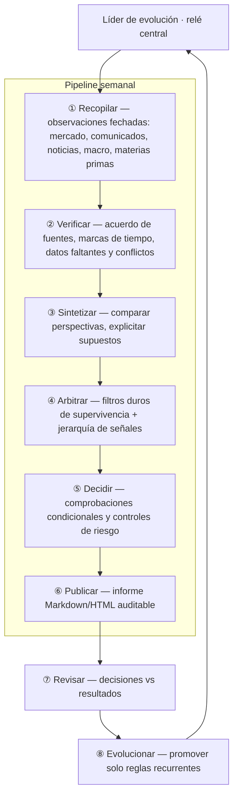
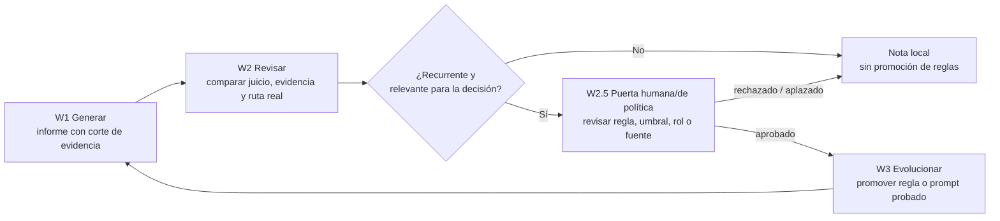

<div align="center">

# Antifragile Decision Loop

### Revisión semanal antifrágil: decisión asistida por el contexto macro

**Recopilar. Verificar. Debatir. Arbitrar. Revisar. Evolucionar.**

Un bucle semanal de investigación evidencia-primero, con un consejo de ocho roles y auto-mejora acotada. Los factores macro verificados ajustan el presupuesto de riesgo — nunca fabrican una conclusión por sí mismos.

[English](../README.md) | [Español](README.es.md) | [简体中文](README.zh-CN.md)

[](../LICENSE)
[](https://www.python.org/)
[](#inicio-r%C3%A1pido)
[](#l%C3%ADmites)

</div>

> [!IMPORTANT]
> Solo para investigación y apoyo a decisiones. No ejecuta ninguna acción externa en tu nombre. No constituye asesoramiento de inversión.

## Idea central

El proyecto convierte una revisión semanal en un proceso auditable:

1. Mide la semana desde el primer dato real hasta el último cierre real.
2. Verifica valores, actividad, fechas y acuerdo entre fuentes antes de interpretar.
3. Tras los filtros de riesgo, da prioridad a la evidencia histórica del canal de tendencia; después revisa indicadores núcleo, flujos de 5/10/20 días, comunicados y, por último, el contexto macro ajusta el presupuesto de riesgo.
4. Una narrativa sin fuente verificable y fechada no es una razón de decisión.
5. Una revisión solo puede usar información pública antes de `evidence_cutoff`; un anuncio posterior es un evento nuevo, no una predicción fallida del informe anterior.

## Consejo de expertos

Ocho roles, un responsable por etapa, todo pasa por el relé central:



| Etapa | Rol | Responsabilidad |
|---|---|---|
| Relé | **Líder de evolución** | Despacho central, puertas de etapa, promoción de reglas |
| ① | **Recopilador** | Extracción única de mercado / comunicados / noticias / macro / materias primas |
| ② | **Verificador** | Validación cruzada en ventanas de 168h + 120h → tabla de hechos |
| ③ | **Sintetizador de evidencia** | Puntuación de seis lentes fusionada vía MCDA (TOPSIS + VIKOR) |
| ④ | **Arbitrador de señales** | Motor de reglas + zona gris de filosofía antifrágil → 🟢🟡🔴 |
| ⑤ | **Decisor** | Traduce el semáforo en zonas de disparo, ajustes de exposición y controles |
| ⑥ | **Editor de investigación** | Markdown → informe HTML autocontenido |
| ⑦ | **Experto en revisión** | Decisiones previas vs resultados → retrospectiva estructurada |
| ⑧ | **Líder de evolución** | Cierra el bucle: consolida, promueve reglas, evoluciona prompts |

Contrato público completo: [`docs/expert-team.md`](expert-team.md).

## Jerarquía de señales

El orden es la disciplina. Cada capa responde solo a su propia pregunta; una capa inferior no puede fabricar una conclusión cuando un filtro superior falla — un escaneo incompleto, datos obsoletos, conflictos de fuente o muestras insuficientes deben permanecer visibles en la salida.

| Capa | Pregunta | Regla |
|---|---|---|
| Integridad de datos | ¿Valores, actividad, fechas y fuentes son utilizables? | Un desacuerdo de fuente sin resolver bloquea conclusiones direccionales. |
| Canal de tendencia | ¿Este patrón semanal/mensual se mantuvo con suficientes muestras? | Es la entrada contextual de mayor peso, no una garantía. |
| Confirmación | ¿Indicadores núcleo y flujos de 5/10/20 días coinciden? | Un movimiento de un día no borra una señal de medio plazo. |
| Evidencia de comunicados | ¿Hay un comunicado fechado que cambie la tesis? | Los eventos posteriores nunca rellenan el informe previo. |
| Contexto macro | ¿Un factor verificado cambia el presupuesto de riesgo? | El contexto puede restringir el riesgo, no fabricar una conclusión. |

## Auto-mejora acotada

**W1 generar → W2 revisar → W2.5 puerta humana/de política → W3 evolucionar → W1**. Los cambios en reglas, umbrales, roles, prompts, fuentes o cadenas de respaldo requieren la puerta W2.5; los arreglos de presentación pueden promoverse automáticamente.



Reglas de promoción: [`evolution-loop.md`](evolution-loop.md).

## Inicio rápido

El núcleo público usa solo la librería estándar de Python: no requiere paquetes de terceros.

```bash
git clone https://github.com/marqosjiang-gif/antifragile-decision-loop.git
cd antifragile-decision-loop

cp focus_list.example.json focus_list.local.json
python3 weekly_review.py --focus-list focus_list.local.json
```

Configure solo sus propios sujetos de estudio en `focus_list.local.json`. El archivo está ignorado por Git: no incluya datos de cuenta ni credenciales.

El archivo generado `weekly_review_YYYYMMDD.md` registra la hora de ejecución, el corte de evidencia, la ventana de validación y la lista de comprobación; permanece fuera de Git.

## Límites

La salida es un andamiaje de investigación con estado `research_only`. Las decisiones reales requieren datos actuales verificados y las restricciones de riesgo del usuario. No publique listas personales, datos de cuenta, informes generados, cachés, correos electrónicos, tokens o claves API.

El núcleo público es adaptable a fuentes: calendarios, sesiones, límites de datos y políticas de actualización pertenecen al adaptador de contexto; no se copian entre fuentes de forma implícita. Los ejemplos usan códigos sintéticos.

Reglas completas: [`PUBLIC_PROTOCOL.md`](../PUBLIC_PROTOCOL.md).

## Licencia

[MIT License](../LICENSE)
