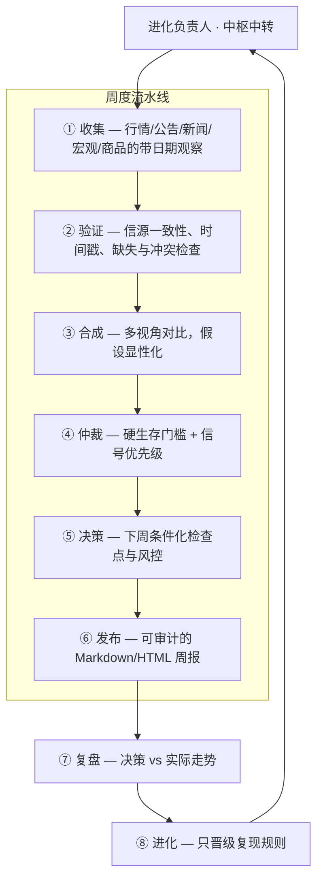

<div align="center">

# 反脆弱决策循环

### 反脆弱视角周复盘：宏观经济形势辅助决策

**收集. 验证. 辩论. 仲裁. 复盘. 进化.**

一个证据优先、多市场可适配的周度复盘闭环：专家团协作 + 有边界的自主进化。已核验的宏观因子只调整风险预算——永不替代技术证据、更不凭空制造交易。

[English](../README.md) | [Español](README.es.md) | [简体中文](README.zh-CN.md)

[](../LICENSE)
[](https://www.python.org/)
[](#市场边界)
[](#有边界的自主进化)
[](#边界)

**[解决什么](#它解决什么问题) · [专家团](#专家团) · [自主进化](#有边界的自主进化) · [快速开始](#快速开始) · [在线预览](preview.html)**

</div>

> [!IMPORTANT]
> 仅用于量化研究和决策辅助，不接券商、不下单，不构成投资建议。

## 它解决什么问题

日内噪声、陈旧新闻和事后回测很容易把周度决策带偏。本项目把中低频研究固化为可检查的顺序：

1. 以本周首个实际开盘到最后实际收盘计算周度表现。
2. 先核对价格、成交量、时间戳和信源一致性。
3. 硬门槛通过后，历史 BOLL（布林带通道）证据优先，再看量价、5/10/20 日资金、公司披露，最后由宏观环境调整风险预算。
4. 没有日期与可复核来源的叙事，不能成为交易理由。
5. 复盘只能使用报告 `evidence_cutoff` 前公开的信息；之后披露的是新事件，不得倒灌为原报告失误。

## 专家团

八名角色各守一个阶段，责任单一、全程留痕——任何产物都必须经过中枢中转：



| 阶段 | 角色 | 职责 |
|---|---|---|
| 中枢 | **进化负责人** | 统一调度、阶段门禁、规则晋级 |
| ① | **信息收集员** | 一键拉取行情 / 公告 / 新闻 / 宏观 / 地缘 / 商品原始信息 |
| ② | **信息校验员** | 168h + 120h 窗口交叉验证 → 事实表 |
| ③ | **证据合成官** | 六视角打分经 MCDA（TOPSIS + VIKOR）合成 → 中立证据矩阵 |
| ④ | **信号仲裁官** | 规则引擎主裁决 + 反脆弱哲学灰区兜底 → 🟢🟡🔴 |
| ⑤ | **操作决策官** | 把红绿灯翻译为触发区间、仓位增减与风控 |
| ⑥ | **投研主编** | Markdown → 自包含 HTML 周报 |
| ⑦ | **复盘专家** | 上周决策 vs 实际走势 → 结构化复盘 |
| ⑧ | **进化负责人** | 收口中转、固化规则、进化 prompt |

专家团机制见 [`专家团协作说明`](expert-team.md)。

## 有边界的自主进化

闭环节奏：**W1 生成 → W2 复盘 → W2.5 人工/政策确认门 → W3 进化 → 下一轮 W1**。决策规则、阈值、角色、prompt、数据源或降级链的变更必须过 W2.5 门；纯排版修正可记录后自动晋级。它能改进研究流程本身；不能下单、不能触碰任何账户、不能悄悄暴露私有数据。


自主进化规则见 [`自主进化闭环`](evolution-loop.md)。

## 快速开始

```bash
git clone https://github.com/marqosjiang-gif/antifragile-decision-loop.git
cd antifragile-decision-loop
python3 -m venv .venv
source .venv/bin/activate
python3 -m pip install -r requirements.txt

cp watchlist.example.json watchlist.local.json
python3 quant_loop.py --watchlist watchlist.local.json
```

请只在 `watchlist.local.json` 中配置自己的研究代码和显示名。该文件已被 Git 忽略；不要填写持仓数量、成本、账户或密钥。

生成的 `weekly_quant_research_YYYYMMDD.md` 包含运行时间、证据截止点、下周验证窗口与自选清单核对项，默认被 Git 忽略。

## 公开版包含什么

- 周度时间口径与可执行回测边界
- BOLL、量价、资金流、公告和宏观信息的证据优先级
- `Via Negativa` 去除未验证叙事
- `report_generated_at`、`evidence_cutoff`、下周验证窗口的审计字段
- 只沉淀跨周复现规则的进化闭环
- 专家团六阶段协作：收集、验证、合成、仲裁、决策、发布

## 信号分层

顺序即纪律。宏观叙事不能推翻有效的 BOLL 证据；BOLL 结果也不能推翻数据冲突、小样本回测或生存风险门槛。

| 层 | 问题 | 规则 |
|---|---|---|
| 数据完整性 | 价格、成交量、日期、信源可用吗？ | 未解决的价格分歧阻断方向性结论。 |
| 历史 BOLL | 这个周/月级别设置有足够已完成样本吗？ | 权重最高的技术输入，但不是保证。 |
| 确认层 | 量价与 5/10/20 日资金一致吗？ | 单日波动抹不掉中期信号。 |
| 公司证据 | 有改变论点的带日期披露吗？ | 后发事件永不回填先前报告。 |
| 宏观背景 | 已核验的因子改变风险预算了吗？ | 背景只能约束风险，不能制造交易。 |

## 市场边界

公开核心不把任何单一市场的制度当成默认规则。交易日历、结算规则、涨跌幅限制、做空规则、除权处理、汇率和流动性假设，都必须由具体市场适配器明确配置；示例不包含真实标的、持仓或账户数据。

详细规则见 [`PUBLIC_PROTOCOL.md`](../PUBLIC_PROTOCOL.md)。

## 边界

生成的周度文件只是一份研究脚手架，默认状态是 `research_only`。真实交易判断必须由使用者补充当期、可验证的数据和自身风险约束。请勿向公开仓库提交个人自选清单、持仓、成本、报告、缓存、邮箱、令牌或 API Key。

## 许可

[MIT License](../LICENSE)
